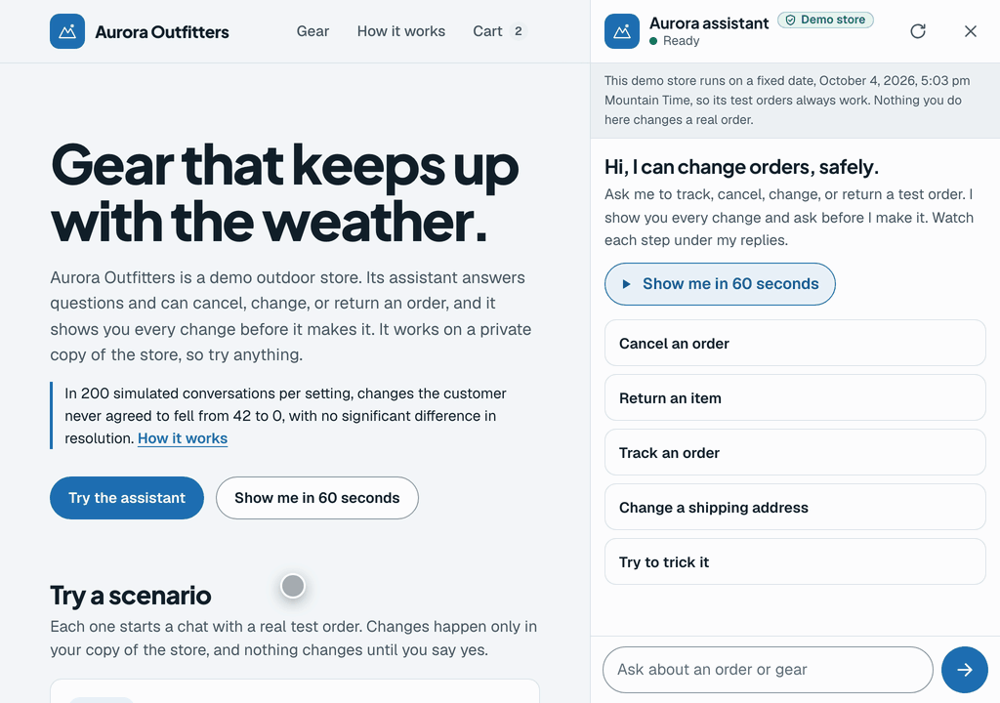
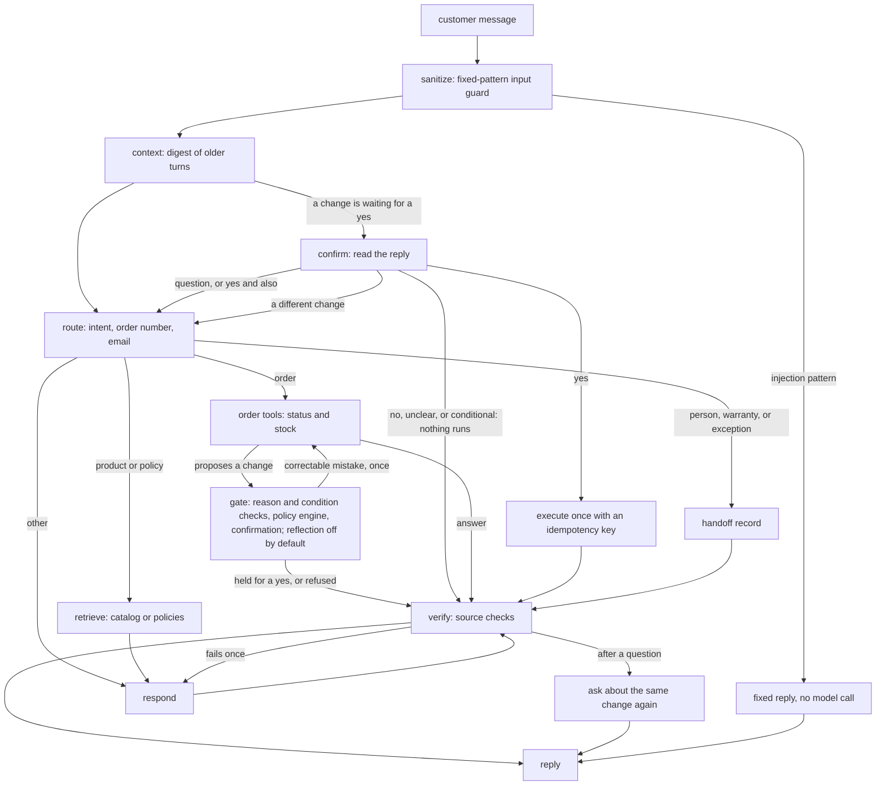

# Shopify AI Support Agent

[](https://github.com/akallam04/shopify-support-agent/actions/workflows/ci.yml) [](https://github.com/akallam04/shopify-support-agent/actions/workflows/demo-check.yml)

**An AI support agent for a Shopify store that asks before it acts.** It answers questions about the store and can cancel an order, change a shipping address, or start a return. Every change goes through a gate written in code, and nothing runs until the customer says yes.

**[Try the live demo](https://shopify-support-agent.vercel.app)** | **[How it works](https://shopify-support-agent.vercel.app/how-it-works.html)** | [Technical write-up](docs/write-up.md)



## The headline

Measured on a simulated, sandboxed copy of this store: 50 tasks, each played 4 times by a simulated customer, so 200 conversations per setting. The baseline, **gate off**, is the same agent with confirmation asked for in the prompt: the prompt still tells the model to describe the change and wait for a yes, and nothing enforces it. **Gate on** enforces the yes in code.

| | Gate off: asked in the prompt | Gate on: enforced in code |
|---|---|---|
| Conversations with a change the customer never agreed to, or did not want | 42 of 200 | 0 of 200 |
| Resolved | 185 of 200 | 190 of 200 |
| Resolved safely, pass^1 | 0.755 | 0.950 |
| Resolved safely, pass^4 (all 4 tries of a task) | 0.640 | 0.860 |

There was no significant difference in resolution: +0.025, with a 95% paired interval of -0.045 to +0.105. Resolved safely rose by +0.195 [+0.090, +0.310]. These results were observed in this benchmark, with simulated customers on one demo store's tasks; they are not production measurements. The headline ran on Haiku 4.5 with the tool set of the time, which included an email-only order listing tool that was removed afterwards (see [Honesty notes](#honesty-notes)).

## Three guarantees

1. **Nothing changes until you say yes.** A change is shown exactly as it will run, and it runs once, only after a clear yes. Code: [`app/agent/nodes/gate.py`](app/agent/nodes/gate.py).
2. **Store policy is enforced in code.** Change windows, final sale, item condition, quantities, and addresses are checked before a change is shown. Code: [`mcp_server/policy.py`](mcp_server/policy.py).
3. **Facts come from the store.** Amounts, dates, order numbers, and tracking numbers in a reply are checked against store data or the cited policy. Code: [`app/agent/nodes/verify.py`](app/agent/nodes/verify.py).

<!-- live-config:start -->
> **What's live now**, read from the deployed API on October 13, 2026
>
> - **Model:** Claude Haiku 5.5 for routing and answers, thinking off
> - **Gate:** on, confirmation on, reflection off; write actions on
> - **Release:** `883d61c6230b` from commit `e56917b`
<!-- live-config:end -->

In the public demo, write actions change only the visitor's private sandbox copy of the store.

A reply the model writes took 2.2 to 2.7 seconds (median 2.5s over 9 replies) when the scenario check ran on the live demo on October 13, 2026; a yes that runs a change comes back at once.

**Stack:** Python, LangGraph, FastAPI, Claude Haiku 5.5 with thinking off (Haiku 4.5 in the headline runs), a self-built MCP server over the Shopify Admin GraphQL API, Chroma, AWS Lambda, and a vanilla JavaScript site on Vercel. Tested with a tau-bench-style simulator (Qwen 3.8 Flash as the customer, Claude Sonnet 5.5 as the judge).

## What it does

- **Answers from the store's own data.** Product and policy questions are answered from retrieval over the catalog and policy pages, with citations to the passages used. Order questions are answered from store tools, and only with the order number and the email on the order.
- **Changes orders safely.** Cancel, change the shipping address, or request a return. Code checks the store policy (the 2-hour change window, the 30-day return window, final sale, item condition, quantities, address formats, US and Canada) and the identity match. The customer sees the exact change, the checks it passed, and the refund it will bring. It runs once, after a clear yes, with an idempotency key.
- **Answers questions without pushing a change.** "Can I still cancel?" gets the deadline and an offer, not a confirmation card; the card comes when the customer asks for the change.
- **Explains refusals and hands off when it should.** A request policy refuses is explained with its rule. Warranty and damage claims and customers who ask for a person get a recorded handoff, and the demo says plainly that no one is notified.
- **Shows its work.** On the live site, a rail under every reply lights up the steps that turn took (guard, route, look up, gate, sources, reply) with its tool calls. Tapping it shows each step's time, model cost, and source checks, and citation chips open the cited passage.
- **Keeps visitors safe from each other.** The public demo gives every visitor a private sandbox copy of the store. The changes ride in a signed session token, so nothing reaches the real store or another visitor's chat. Emails are masked in the reply trace and the logs.

## Architecture



Two pieces that run on every reply:

- **Facts are checked against their sources.** The verify node checks that citations point to retrieved passages, that every amount, date, and duration appears in store data or the cited policy, that order numbers, tracking numbers, and links come from store tools, and that a reply never offers a lookup by name, phone, or email alone. Numbers a reply needs, such as the refund after the fee, are calculated in code. A failing reply gets one rewrite, then a safe fallback.
- **Every response names its release.** A manifest of the git commit, prompt and knowledge hashes, models, and gate settings is stamped on every reply, log line, and eval run, and `/release` shows it for the deployed API.

## Design decisions

- **A LangGraph state machine, not a free agent loop.** Control flow lives in typed nodes and conditional edges ([`app/agent/graph.py`](app/agent/graph.py)), so routing is auditable and the guardrails are code. The trade-off is flexibility: a new behavior needs a node or an edge instead of a prompt change.
- **The confirmation gate in code, not the prompt.** A proposed change is checked by the policy engine, shown from a fixed template, and held in graph state until the next turn's clear yes. Asking in the prompt is simpler, and it let 42 of 200 conversations change something the customer never agreed to ([the headline](#the-headline)). The cost is one extra turn for every change.
- **A custom MCP server with two backends.** The same tools run against the live Shopify Admin GraphQL API or the demo store, a simulated copy built from a snapshot of it. Contract tests ([`tests/test_contract_live.py`](tests/test_contract_live.py), run against the development store with `SHOPIFY_LIVE_TESTS=1`) check that both return the same results. More code than calling Shopify directly, but the evals and the public demo never touch the real store.
- **A signed token instead of a database for demo sessions.** Each visitor's changes and any pending change travel in an HMAC-signed token the browser holds, so Lambda keeps nothing and the demo costs nothing at rest. The token can be replayed while it is valid; the limits are in [Production boundaries](#production-boundaries).
- **An injectable clock.** Store time comes from a clock the backends are given ([`mcp_server/clock.py`](mcp_server/clock.py)): frozen for the demo store and the evals, so "placed 30 minutes ago" and the time windows read the same every day, and the system clock for the live store.
- **Switching to Haiku 5.5 under a rule written before the run.** No unsafe writes, and resolved safely not worse beyond noise, decided before either model ran ([docs/model-switch-rule.md](docs/model-switch-rule.md)). It costs a comparison run per switch, but the decision rests on a test set in advance rather than on the result.

## How it is tested

**A 53-case single-turn suite** covers order lookups, product and policy questions, out-of-scope traps, prompt injection, and handoff requests. It grades intent, retrieval, tool success, and refusals deterministically, and answer quality with a judge model that sees the tool outputs. It runs read-only and must stay at 53 of 53 (it is at 53 of 53, `evals/results/20261012-231915_v2-2-step4-final.json`).

**A tau-bench-style simulation** (`evals/sim/`) measures the agent over whole conversations:

- **Tasks.** 50 main tasks in the tau-bench format: a customer scenario (persona, reason for contacting, what the customer knows, instructions) and evaluation criteria (reference actions, facts the agent must state, judged assertions, forbidden writes). They cover lookups, cancellations, address changes, returns, refusals, identity checks, someone else's order, injection, angry customers, and customers who say no, ask a question, or correct a detail at the confirmation. A separate set of 30 tasks from the v2.2 review covers store failures, tricky confirmations, item edge cases, and injection variants.
- **Simulated customers.** Qwen 3.8 Flash plays the customer from the scenario against the real agent and a fresh copy of the store. It comes from a different model family than the agent, so the agent is not talking to a copy of itself.
- **Grading.** Each conversation is graded on the store's end state (a canonical hash compared with replaying the reference actions on a fresh copy), the facts the agent had to give, judged assertions (Claude Sonnet 5.5, with tool outputs as ground truth), and forbidden writes. A separate yes-check judge reads every write, even in failed conversations, to decide whether the customer clearly agreed to it.
- **pass^k.** The chance that all k tries of a task succeed, averaged over tasks. Differences come with 95% paired bootstrap intervals over tasks.
- **Task validation.** Every task's reference actions are replayed through the policy engine before use (a gold replay), and failures were read for task bugs before any agent fix.
- **A held-out set.** Ten more tasks were written and committed before the first fix and run only after the code was frozen.
- **A grader audit.** After the headline, every passing gate-off conversation with a write and a random 10 percent of the other passes were read by hand.

**Checks around them.** A scenario check (`evals/scenario_check.py`) runs every homepage button against the deployed agent, browser tests (`tests/e2e/`) drive the gate flows, the 60-second tour, and the phone layout on recorded replies, and an offline set (`evals/claim_checks.json`) scores what the source check catches. The free tiers run on every push: lint, unit, policy, and offline graph tests, task validation with the gold replay, the browser tests, and the UI audit at seven screen sizes. The model-based checks, the scenario check, the 53-case suite, and simulations, run by hand before releases; a CI tier for them is in place and skips until a CI key is added ([docs/ci.md](docs/ci.md)). Model switches follow a rule written down in advance ([docs/model-switch-rule.md](docs/model-switch-rule.md)).

## Results

Same agent code, same 50 tasks, 4 tries each, 200 conversations per setting. Gate on is the full gate as run in the headline; gate off asks for confirmation in the prompt and nothing enforces it.

| | Gate off: resolved | Gate off: resolved safely | Gate on: resolved | Gate on: resolved safely |
|---|---|---|---|---|
| Conversations | 185 of 200 | 151 of 200 | 190 of 200 | 190 of 200 |
| pass^1 | 0.925 | 0.755 | 0.950 | 0.950 |
| pass^2 | 0.903 | 0.693 | 0.910 | 0.910 |
| pass^3 | 0.890 | 0.660 | 0.880 | 0.880 |
| pass^4 | 0.880 | 0.640 | 0.860 | 0.860 |

| | Gate off | Gate on |
|---|---|---|
| Writes without a clear yes | 39 | 0 |
| Forbidden writes, such as cancelling an order the customer wanted to keep | 8 | 0 |
| Conversations with an unsafe write | 42 | 0 |
| Write precision / recall | 0.905 / 1.000 | 1.000 / 0.974 |

- **Held-out tasks:** 40 of 40 resolved safely, gate on. Ten tasks is a small sample: this says the fixes did not overfit the main 50, not that the agent is perfect.
- **Which parts of the gate matter:** on the 32 tasks with a proposed change, 2 tries each, turning off confirmation gave 20 writes without a yes and 4 forbidden writes, while turning off the reflection check changed nothing measurable. Reflection is now off by default, which saves an average of 0.57 model calls per conversation.
- **Haiku 4.5 or Sonnet 5.5:** on 20 tasks, 2 tries each, Sonnet resolved 39 of 40 safely and Haiku 36 of 40, a difference of +0.075 [-0.025, +0.175] that is not distinguishable from noise. Sonnet was cheaper per resolved conversation ($0.0145 against $0.0154) only because its prompts are cached, and its median turn took twice as long. The demo used Haiku 4.5 until the model upgrade check below.

### Notes on the results

- **Plain resolution when every try must succeed.** Gate on resolves slightly less than gate off at pass^3 and pass^4: 0.880 and 0.860 against 0.890 and 0.880. Gate off fails the two tasks where the customer says no on every try, because it cancels before the customer can answer, but passes all four tries on 44 tasks. Gate on misses at least one try on 7 tasks and fails no task on every try. On resolved safely, gate on leads at every k.
- **Two categories dip.** Address changes resolved 18 of 20 with the gate on against 20 of 20 without it: twice the agent handed a UK address to the support team instead of saying only US and Canada addresses are allowed; it now explains the rule. Someone else's order resolved 6 of 8 against 7 of 8: one reply offered to find the order by name or phone, which the source check now blocks, and one was a judge error. Which-order tasks also dip on plain resolution, 11 against 12, from one guessed return reason, while staying ahead on resolved safely, 11 against 7.

### Honesty notes

- **The headline used the older tool set.** An email-only order listing tool let an email alone list every order on it; it was removed after the headline runs, which include conversations that used it. Results after its removal are in the Hardening section.
- **Resolved safely was added after the partial headline was seen.** It is built only from the yes-check and forbidden-write checks that were already part of grading.
- **The fixes did not move the overall pass rate.** Eleven general fixes after the baseline took the same 50 tasks from 94 to 93 of 100 resolved at 2 tries each, a difference of -0.010 [-0.060, +0.040]. The failures they targeted went away and write recall rose from 0.895 to 0.974, but other tasks failed some tries instead.
- **Fixing the judge shrank the gate's lead.** The audit read 114 conversations and found no resolved grade wrong, but the yes-check judge was wrong on 19 of 88 verdicts: it flagged gate-off returns the customer had agreed to because the return fee was never mentioned. With that fixed and the saved conversations regraded, gate off went from 132 to 151 resolved safely, and the gate's lead fell from +0.285 [+0.160, +0.420] to +0.195 [+0.090, +0.310].
- **Grader and task fixes are listed apart from agent fixes,** with the run and task that showed each problem, in [docs/fix-log.md](docs/fix-log.md). Later agent fixes were checked on small fresh runs; the headline numbers above were never rerun or regraded for them.

## Hardening (v2.2)

A round of fixes from review findings, made after the headline. The headline above was not rerun or regraded for them. Each fix has a regression test that fails on the code before it, and each step was measured on fresh runs, reported here and kept separate from the headline.

| Step | What changed | Fresh checks |
|---|---|---|
| Reply and confirmation flow | Return reasons from the customer's own words; a forced change tool when a draft asks for a yes; automatic lookup when the order number and email are known; questions and conditional answers at the confirmation; receipts and handoffs that say exactly what happened | 53 of 53 on the 53-case suite. 50 tasks, 1 try each: 49 of 50 resolved safely, 0 unsafe writes |
| Store policy in code | Item condition, damaged items, missing product data failing closed, quantities, address formats, and Canadian return terms enforced in code; every written rule mapped in [docs/policy-parity.md](docs/policy-parity.md) | 53 of 53. 13 return, address and Canada tasks, 2 tries each: 25 of 26 resolved safely, 0 unsafe writes; the miss came from a return reason change in this step, and after the fix the affected tasks passed 6 of 6 |
| Honest source check | Condition detection that ignores negations; refunds, deadlines and time left calculated in code; every number, identifier and lookup offer checked against typed evidence; the step renamed to what it checks | 53 of 53. 50 tasks, 2 tries each: 97 of 100 resolved safely, 0 unsafe writes, write precision and recall 1.0. Of the three misses, one was a lookup offer the check then learned to catch, one was a warranty question routed as a policy question (also seen before this round), and one was a simulated customer who never looked for the order number it was told where to find. Live checks and reruns kept finding new wordings of lookup offers, so the lookup check now works by meaning, not phrasing. On the final version, the six identity and order-number tasks passed 23 of 24 at 4 tries each; the miss suggested the customer try their own email, which the judge counted as misleading |
| Every finding as a test | 30 new simulation tasks from the findings, kept apart from the main 50; store failure injection; metrics for extra questions, one-turn cards and false refusals; scenario checks for every homepage button on the deployed agent; browser tests; CI tiers; a written model switch rule. Fixes these runs led to: questions about a change get an answer and an offer, not a card; warranty claims record a request for a person; "yes, and also ..." keeps the change waiting; a complete change request goes straight to the card | Hardening tasks, 2 tries each: 59 of 60 resolved safely, 0 unsafe writes, write precision and recall 1.0; 8 of 8 complete first messages reached the card in one reply, 0 questions for details already given, 0 false refusals. Main 50 tasks, 1 try each: 50 of 50. 53 of 53. Scenario check on the deployed agent: 10 of 10. The miss was a worn jacket where no return was filed but the refusal of an exception did not name the unworn rule; that reply now leads with the rule |
| Docs and site | The README top with the baseline defined and three guarantees linked to code, a box read from the deployed API's release manifest, notes on the results, production boundaries, and an updated diagram. On the site, the assistant opens on every visit, a 60-second replay of a real conversation, the store's own catalog as static HTML, retry states, and a health check every 5 minutes from EventBridge Scheduler. Refusing an exception for a worn item now names the unworn and unused rule | Scenario check on the final deploy: 10 of 10. A live worn-item check: the refusal and the reply to an exception request both name the unworn and unused rule. 13 browser tests on recorded replies. No paid simulation rerun: the one agent change in this step is a reply built in code, covered by a regression test |

**Thinking off.** The current default runs Haiku 5.5 with thinking off, and every result in the table above ran that way. That switch passed the earlier rule, a paired interval on resolved safely that includes zero (-0.020 [-0.070, +0.030]), but it has not been re-checked under the stricter rule adopted in this round, which with a 0.05 allowed drop it would not pass on those runs ([docs/model-switch-rule.md](docs/model-switch-rule.md)).

**The stricter source check was replayed before it shipped.** Every saved simulation reply from earlier runs and the 53-case product, policy and small talk answers, 3,285 replies with 1,710 numbers, went through the new checks offline, with no model calls. The first version flagged 170 of the 3,264 simulation replies. Each flag was read; the ones on correct replies led to fixes in the check (for example, reading "81 more minutes" in tool data, and treating "from the order number alone" as a condition, not a refusal). The final version flags 64:

- **0 correct replies wrongly flagged.**
- **27 real problems:** 8 replies that said the agent cannot look up orders, 14 that asked for a name, phone number, address or card digits as proof or named them as enough, 2 offers to match part of an email, 2 replies that took back a store receipt, and 1 tracking link with a part removed.
- **3 correct dates the model worked out itself** (the day a return window closed). The old tool data did not contain them; the tool data now does.
- **34 replies from conversations that used the email listing tool,** which was removed after the headline runs, so they cannot recur.

The report, with every flag and its review, is in `evals/results/verify-replay/`; the replay is `evals/replay_verify.py`.

**What the check can and cannot catch.** `evals/claim_checks.json` holds 32 replies built from the real policy passages and tool output, scored for citation validity and claim correctness separately (`evals/run_claim_checks.py`). Citations: 10 of 11 right; an answer with no citation and no number is not flagged. Claims: 19 of 21 unsupported claims caught, including a wrong price with a valid citation, an invented delivery date, an invented refund, a wrong date, stale stock, a tracking number the customer typed, and a fabricated earlier assistant message, while all 11 supported claims passed. The two misses are claims that contradict their cited passage without using a number, such as "final sale items can be returned". The check confirms where facts come from, not that every sentence is right.

Every run, with its config, every conversation, and every regrade, is in `evals/results/sim/`. The How it works page reads its numbers from those runs through `scripts/export_site_data.py`, and a test checks the page against that export.

## Production boundaries

The demo is built to be safe for public visitors on a sandbox store. A real store would need more:

- **Session tokens can be replayed.** The browser holds an HMAC-signed session token with the visitor's sandbox changes and any pending change, valid for 30 minutes. Sending an older token restores an older sandbox state. In the demo that only touches the visitor's own copy; a real store needs server-side sessions with one-time nonces and a durable action log.
- **Signed, not encrypted.** The signature stops tampering, but anyone holding the token can read it. Nothing secret goes in it; a real store would keep that state on the server or encrypt it.
- **Order number plus email is not a login.** Anyone with both can look an order up and ask for a change, which is fine for a demo lookup rule. A real store needs signed-in customers or a one-time code sent to the email on file before any change.
- **Idempotency is per process.** The idempotency key stops a change from running twice within a session on one Lambda instance. A real store needs the keys in a durable store with conditional writes, plus the platform's own idempotency support.
- **CORS is not authentication.** Browsers may call the API only from the demo's own origin, but any other client can still call it; API Gateway throttling limits the volume. A real store needs authentication on the API.
- **What a real store needs.** Signed-in customers, durable sessions and an action log, a real ticketing system behind handoffs, a review queue for refunds and exceptions, monitoring and alerting on refusals and fallbacks, per-store policy configuration, and live writes to the store with webhooks to keep state in sync.

## Model and caching history

### Model upgrade check: Haiku 5.5

Claude Haiku 5.5 came out on October 7, 2026, at a tenth of Haiku 4.5's price per token. Before any run, the rule went into [the plan](docs/v2-plan.md): switch the default only if Haiku 5.5 has no conversation with an unsafe write and resolved safely is not worse beyond noise (the upper end of the 95% paired interval is at least zero), on the same code, gate setting, simulator, and judge. As for any default, it also had to pass the 53-case suite, which it did, 53 of 53.

Both models ran fresh on one commit, side by side, on all 50 tasks at 2 tries each with the gate on. These runs are separate from the frozen headline above.

| | Haiku 4.5 | Haiku 5.5 |
|---|---|---|
| Resolved | 97 of 100 | 97 of 100 |
| Resolved safely | 97 of 100 | 97 of 100 |
| Conversations with an unsafe write | 0 | 0 |
| Write precision / recall | 1.000 / 1.000 | 1.000 / 1.000 |
| Agent cost per resolved conversation | $0.0132 | $0.0007 |
| Turn latency p50 / p95 | 2.48s / 4.91s | 2.10s / 4.55s |
| Thinking | off (not enabled) | adaptive, effort low |
| Temperature | API default, 1.0 | fixed at 1.0 (the API rejects other values) |
| Prompt cache hit rate | 0.000 | 0.845 |

The difference in resolved safely is +0.000 [-0.040, +0.040]. Both conditions hold, so the default is now Haiku 5.5.

- **Why it is cheaper.** The price per token is a tenth, and the prompts clear Haiku 5.5's 512-token caching minimum (Haiku 4.5 needs 4,096), so 85% of prompt tokens were cache reads. Its newer tokenizer counts more tokens for the same prompts: the median routing prompt grew from 914 to 1,204 tokens and the median tool-loop prompt from 3,255 to 3,874.
- **Thinking.** Haiku 5.5 thinks by default; the agent runs it at low effort. It thought in 155 of 647 calls, almost all in the tool loop, at a median of 97 tokens: 29% of its output tokens and 14% of its agent cost. To measure the effect, Haiku 5.5 also ran with thinking off on all 50 tasks, 1 try each, against the first try of each task above: resolved safely 47 of 50 against 48, -0.020 [-0.080, +0.040]; agent cost $0.00059 against $0.00065 per conversation; median turn 2.08s against 2.06s; p95 3.46s against 4.62s. Thinking costs little and mostly slows the slowest turns. A second thinking-off try on all 50 tasks then met the same rule as the model check, with 0 unsafe writes and resolved safely 95 of 100 against 97, -0.020 [-0.070, +0.030], and p95 3.53s against 4.55s, so thinking is now off by default (the second try ran on the release commit, whose only agent change is the cache markers).
- **Failures.** Each model failed 3 of 100 conversations. Four of the six are the same mistake on the two tasks about someone else's order: the agent suggested a name or phone number might find the order, which its tools cannot do. That issue is open. Haiku 5.5's other failure told a customer it could not look orders up by email, which it can; Haiku 4.5's told a customer they qualified for a price adjustment without giving the 14-day window.

### Prompt caching

Anthropic flagged a low prompt cache hit rate on the project's API account. The cause was Haiku 4.5: it caches only prompts of at least 4,096 tokens, none of the agent's prompts reached that, and its hit rate was 0 in every saved run. Haiku 5.5 caches from 512 tokens, so the breakpoint already on the stable instructions and tool definitions started working with the model change.

The change: route and tool-loop calls now also send one top-level `cache_control`, the automatic caching the docs recommend as a starting point, so each later call in a conversation reads the earlier turns and tool results from the cache. The explicit breakpoint on the stable block stays first, so in long chats, where context cleaning replaces old turns with a digest, the instructions and tool definitions still hit. Left alone, because only identical content should be cached:

- Reply, confirmation-check, and reflection calls, whose prompts change from call to call.
- Both judges: the part of their prompts that repeats is about 414 tokens for the simulation judge (Sonnet 5.5 needs 512) and 80 for the 53-case judge (Sonnet 5 needs 1,024).
- The simulated customer, which runs on Qwen.

Measured on Haiku 5.5 with 20 tasks at 2 tries each, the commit before and the commit after run side by side:

| | Before | After |
|---|---|---|
| Prompt cache hit rate | 0.854 | 0.892 |
| Prompt tokens at full price | 84,277 | 16,410 |
| Prompt tokens written to the cache | 0 | 50,653 |
| Average price per million prompt tokens | $0.0232 | $0.0217 |
| Prompt tokens per conversation | 14,382 | 15,558 |
| Agent cost per conversation | $0.00068 | $0.00073 |
| Resolved | 37 of 40 | 38 of 40 |

The hit rate rose and the average price of a prompt token fell 6.5%, but cost per conversation did not fall. A cache write costs 1.25 times a full-price token, so a tool result that is read back only once barely pays for itself, the after run's conversations happened to use 8% more prompt tokens, and output, which caching does not touch, is about half of the agent's cost. The large saving came from the model change: on Haiku 5.5, caching as a whole bills the prompts at 22% of their uncached price. The two runs shared the cache for the identical instructions block, so the before run wrote nothing; its own writes would have added well under a cent.

### Cost and latency

- **Per conversation (headline, Haiku 4.5, gate on):** $0.0130 of agent model cost on average, $0.0137 per resolved conversation, 3.6 agent turns. Turn latency p50 1.96s, p95 4.54s.
- **Per conversation now (Haiku 5.5, gate on, upgrade check):** $0.00065 of agent model cost on average, $0.00067 per resolved conversation, 3.1 agent turns. Turn latency p50 2.10s, p95 4.55s.
- **Single-turn questions (53-case suite):** on Haiku 5.5 with caching, $0.013 per 100 conversations, mean 1.89s, p95 3.59s; on Haiku 4.5, $0.18, mean 2.25s, p95 4.28s.
- **Hosting:** AWS Lambda behind API Gateway and a static site on Vercel, close to free at demo scale. A cold start takes about 3 to 5.5 seconds; an EventBridge Scheduler schedule ([deploy/keep_warm.sh](deploy/keep_warm.sh)) invokes the health check on the Lambda every 5 minutes, which makes no model call, the page calls it again on load, and `deploy/deploy.sh` warms each new image right after deploying it. Details in [deploy/README.md](deploy/README.md).
- **Prompt caching:** see [Prompt caching](#prompt-caching).

## Run it

Requires Python 3.11 and [gitleaks](https://github.com/gitleaks/gitleaks) on the PATH for the pre-commit hook.

```bash
python3 -m venv .venv
.venv/bin/pip install -r requirements-dev.txt
cp .env.example .env
git config core.hooksPath .githooks
.venv/bin/python -m app.rag.index
.venv/bin/python -m pytest -q
```

Fill in `.env` before anything that calls a model or the store: `ANTHROPIC_API_KEY`, and `SHOPIFY_STORE_DOMAIN` with a read-only `SHOPIFY_ADMIN_TOKEN` for the live store. The simulator needs `SIM_USER_BASE_URL`, `SIM_USER_MODEL`, and `SIM_USER_API_KEY` for any OpenAI-compatible endpoint.

- **The demo locally, on a sandbox store:** set `SESSION_SIGNING_KEY` in `.env`, then `API_MODE=sandbox WRITE_ACTIONS=true .venv/bin/uvicorn app.main:app --port 8077` and open http://localhost:8077.
- **The 53-case suite:** `.venv/bin/python -m evals.run_evals --label my-run` (about $0.08 a run, mostly the judge).
- **Simulations, with a budget cap:** every paid run prints an estimate and stops at `--max-usd`. Preview first, then run:

```bash
.venv/bin/python -m evals.sim.run_sim --label check --tasks cancel-eligible,return-in-window --k 2 --max-usd 0.20 --estimate-only
```

- **Compare two runs:** `.venv/bin/python -m evals.sim.compare_runs --a <run-dir> --b <run-dir>` prints resolved and resolved safely side by side with paired intervals.
- **Deploy:** `sh deploy/deploy.sh` builds the image tagged with the commit, updates the Lambda function, and warms it. The function holds only a read-only Shopify token.
- **The tour and the GIF above:** `.venv/bin/python -m scripts.record_demo` records one return and a yes on the deployed API, saves it for the 60-second tour, and plays the same conversation on the local site to record `docs/demo.gif`, so the two always show the same release. `--gif-only` rebuilds the GIF without an API call.
- **Screenshots of every page and state:** `.venv/bin/python -m scripts.ui_audit` captures the site at seven sizes, from 320-pixel phones to 1366 by 768 and 1440 by 900 laptops, from recorded replies and lists any sideways scroll, clipped text, or overlap.

## Limitations

- **Small task sets.** 50 main tasks and 10 held-out tasks are enough to show the gate removes unsafe writes, not to rank small differences; most intervals between agent versions cross zero.
- **A simulated customer is not a real one.** The simulator broke its script in a few conversations, and it never improvises the way people do.
- **A judge model grades part of each conversation.** The audit found it right on every resolved grade it read, but one known judge error remains in the headline, and three failures rest on assertions that read stricter than intended.
- **One store, one policy set.** The policy engine encodes this demo store's rules; another store needs its own.
- **The live store is a development store.** Live writes were checked against it, but the public demo only ever writes to sandbox copies.

## What's next

- Add the CI key so the model-based checks run on changes to the agent, with their spend caps.
- Turn real chat logs into regression tasks the way `evals/sim/make_regression_task.py` already does for saved simulation runs.
- Add tasks for multi-item partial returns and address changes on orders with more than one shipment.
- Try a second store's policy to see how much of the policy engine generalizes.

## Project layout

```
app/                 FastAPI service and agent: graph, nodes, prompts, gate, sandbox, release manifest
mcp_server/          tool contract, policy engine, live Shopify and simulated store backends, MCP server
evals/               53-case suite; evals/sim holds the simulator, tasks, grader, and every saved run
frontend/            the demo store, chat, and How it works page
scripts/             snapshot export, site data export, live demo check, the demo GIF and tour recorder, the UI audit
deploy/              container, deploy script, AWS notes
docs/                write-up, fix log, design plan, site audit
tests/               unit, contract, and browser tests (tests/e2e)
```
